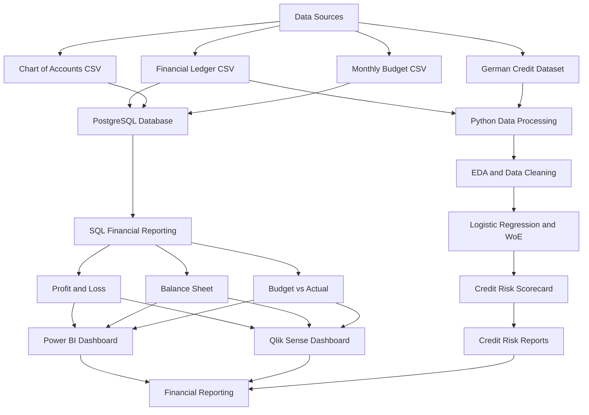

# Financial Analytics and Risk Reporting System — Architecture

## Architecture Explanation

1. **Data Sources:** Financial ledger, chart of accounts, monthly budget and German Credit dataset.
2. **PostgreSQL:** Stores financial data and supports SQL reporting.
3. **Python:** Performs data cleaning, exploratory analysis and credit risk modeling.
4. **Credit Risk Model:** Uses Logistic Regression and WoE to generate a risk scorecard.
5. **Power BI and Qlik Sense:** Provide interactive financial dashboards.
6. **Reports:** Present financial performance and credit risk findings.