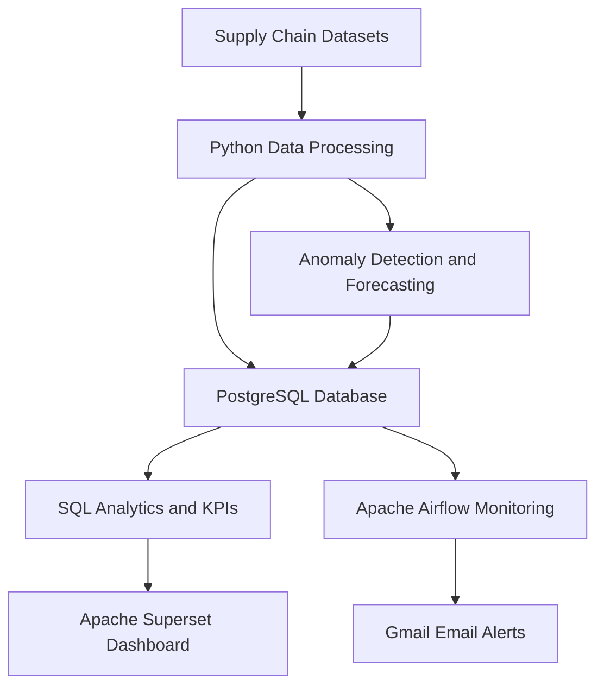
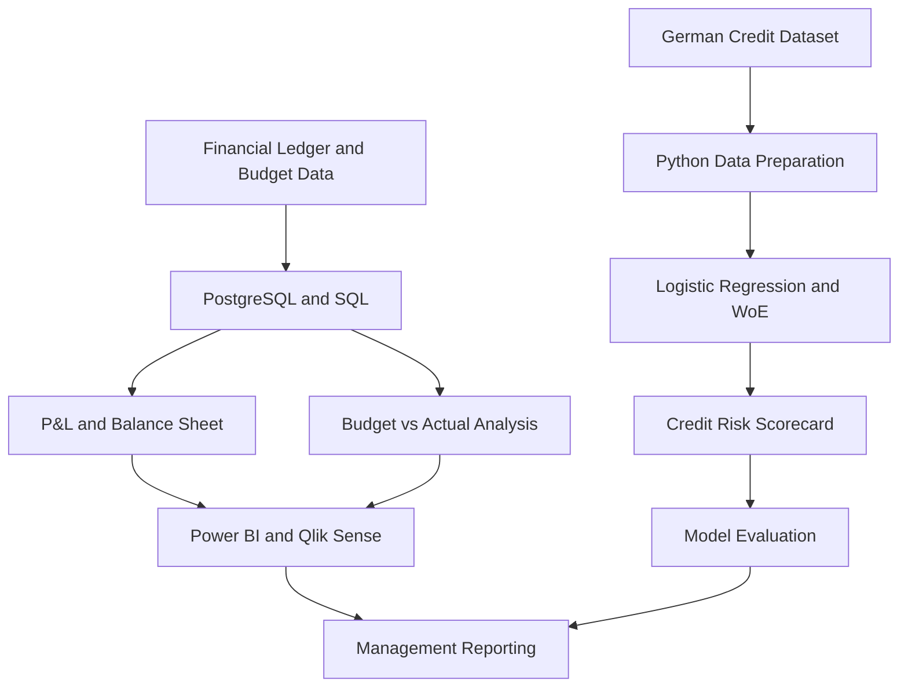

# Nexvia Capstone Projects

This repository contains two end-to-end data analytics capstone projects completed as part of the Nexvia programme.

1. **DA-03 – Retail Supply Chain Control Tower**
2. **DA-04 – Financial Analytics and Risk Reporting System**

These projects demonstrate practical experience in Python, SQL, PostgreSQL, data analysis, predictive modelling, business intelligence, dashboard development, and workflow automation.

## Repository Overview

| Project | Purpose | Main Technologies |
|---|---|---|
| DA-03 | Supply-chain monitoring, forecasting, anomaly detection and operational alerts | Python, PostgreSQL, Airflow, Superset, Prophet, Docker |
| DA-04 | Financial reporting, budget analysis, credit-risk modelling and scorecards | Python, PostgreSQL, Scikit-learn, Power BI, Qlik Sense, DAX |

For detailed project-specific instructions, see:
- [DA-03 Documentation](DA-03/README.md)
- [DA-04 Documentation](DA-04/Documentation/README.md)

---

# DA-03 – Retail Supply Chain Control Tower

## 1. Project Overview

The Retail Supply Chain Control Tower is a data analytics solution designed to monitor inventory, shipment performance, supplier efficiency, and product demand.

The system processes supply-chain data, stores it in PostgreSQL, performs analytics using Python, and presents business insights through an interactive Apache Superset dashboard.

Apache Airflow provides scheduled monitoring and supports Gmail notifications.

## 2. Problem Statement

Retail businesses manage large amounts of data relating to suppliers, inventory, shipments, products, and demand.

Analysing these datasets separately makes it difficult to identify:
- Low-stock and stock-out situations.
- Shipment delays.
- Supplier performance issues.
- Unusual demand patterns.
- Potential future inventory shortages.

The project addresses these challenges through centralized data analysis, forecasting, dashboards, and monitoring.

## 3. Architecture



### Architecture Components

1. **Data sources:** supplier, product, inventory, shipment, and demand-history datasets.
2. **Python:** data cleaning, KPI calculations, exploratory analysis, anomaly detection, and forecasting.
3. **PostgreSQL:** stores the operational datasets and analytical summaries.
4. **SQL:** supports KPI calculations and reporting queries.
5. **Apache Superset:** provides interactive operational dashboards.
6. **Apache Airflow:** monitors existing database tables and risk summaries on an hourly schedule.
7. **Gmail SMTP:** sends configured risk notifications.

**Important:** The current hourly Airflow workflow checks existing database records, logs table counts and execution status, and supports alerts. It does not regenerate the datasets or rerun forecasting and anomaly-detection models every hour.

## 4. Features

### Inventory Monitoring
- Inventory-level analysis.
- Low-stock identification.
- Stock-out rate calculation.
- Inventory coverage analysis.

### Shipment Analysis
- Shipment status distribution.
- On-time delivery analysis.
- Delivery performance monitoring.

### Supplier Performance
- Supplier lead-time analysis.
- Supplier delivery performance.
- Identification of unusual lead times.

### Anomaly Detection
- Detection of unusual shipment lead times.
- Detection of demand spikes.

### Demand Forecasting
- Prophet-based demand forecasting.
- Forecasting for 20 selected products.
- High and Moderate stock-out risk classification.

### Interactive Dashboard
The Apache Superset dashboard includes:
- Inventory KPIs.
- Shipment performance.
- Supplier performance.
- Demand forecasts.
- Anomaly summaries.
- Inventory and stock-out analysis.

### Workflow Automation
- Hourly Airflow monitoring.
- Database record-count logging.
- Gmail SMTP notifications.
- Duplicate alert prevention using alert signatures.

## 5. Dataset Overview

| Dataset | Records |
|---|---:|
| Suppliers | 100 |
| Products | 1,000 |
| Inventory | 10,000 |
| Shipments | 50,000 |
| Demand History | 365,000 |
| **Total** | **426,100** |

## 6. Key Results

| KPI | Result |
|---|---:|
| Stock-out Rate | 0.21% |
| On-time Delivery Rate | 43.25% |
| Average Supplier Lead Time | 18.32 days |
| Average Days of Inventory | 81.59 days |
| Low-stock Records | 1,212 |
| Unusual Shipment Lead-time Records | 33 |
| Demand Spikes | 768 |
| Products Forecast | 20 |
| High-risk Products | 17 |
| Moderate-risk Products | 3 |

These results describe the project dataset and its analysis.

## 7. Installation and Execution

### Prerequisites

- Git
- Python 3.12 or later
- PostgreSQL
- Docker Desktop
- Docker Compose
- Gmail account with an app password for SMTP alerts

### Step 1 – Clone the Repository

```bash
git clone https://github.com/Bikki2715/Dhanalakshmi-Bikki-Capstone-Projects.git
cd Dhanalakshmi-Bikki-Capstone-Projects
```

### Step 2 – Configure PostgreSQL

1. Start PostgreSQL.
2. Create a database named `retail_supply_chain`.
3. Review the SQL scripts in `DA-03/SQL/`.
4. Load the required datasets.
5. Confirm that the following tables exist:

```text
suppliers
products
inventory
shipments
demand_history
```

The monitoring workflow also requires the analytical summary tables:

```text
anomaly_detection_summary
demand_forecast_summary
```

### Step 3 – Configure Environment Variables

Create a `.env` file inside the `DA-03` folder.

```dotenv
DB_PASSWORD=your_postgresql_password
SMTP_HOST=smtp.gmail.com
SMTP_PORT=587
SMTP_USER=your_gmail_address
SMTP_PASSWORD=your_gmail_app_password
ALERT_EMAIL_TO=recipient_email_address
```

Use your own credentials. Do not upload the `.env` file or passwords to GitHub.

### Step 4 – Start Docker Services

Open a terminal in the Docker folder:

```bash
cd DA-03/Docker
docker compose up -d --build
```

Check the running services:

```bash
docker compose ps
```

View logs:

```bash
docker compose logs -f
```

### Step 5 – Access Applications

| Application | Local URL |
|---|---|
| Apache Airflow | http://localhost:8080 |
| Apache Superset | http://localhost:8088 |

The applications run locally. Airflow login details can be checked in its container logs. Change demonstration Superset credentials and secret keys before any use outside a private development environment.

### Step 6 – Python Environment

From the DA-03 project folder:

```bash
python -m venv .venv
```

On Windows PowerShell:

```powershell
.\.venv\Scripts\Activate.ps1
python -m pip install --upgrade pip
python -m pip install pandas numpy matplotlib scikit-learn prophet sqlalchemy psycopg2-binary
```

Review the scripts in `DA-03/Code/` and execute them with the required datasets and database configuration.

### Step 7 – Stop Docker Services

From `DA-03/Docker/`:

```bash
docker compose down
```

This stops the services while retaining named Docker volumes.

## 8. Project Links

- [DA-03 Source Code and Documentation](DA-03/)
- [Dashboard PDF](DA-03/Superset/retail-supply-chain-control-tower-inventory-operations-dashboard-2026-11-07T10-31-04.295Z.pdf)
- [Dashboard Export ZIP](DA-03/Superset/Retail_Supply_Chain_Dashboard_Export.zip)
- [Project Showcase Website](https://retail-supply-chain-control-tower-v.vercel.app/)

The Vercel page is a project showcase, not a public deployment of the live PostgreSQL, Airflow, or Superset environment.

---

# DA-04 – Financial Analytics and Risk Reporting System

## 1. Project Overview

The Financial Analytics and Risk Reporting System combines financial reporting, budget-versus-actual analysis, and credit-risk modelling.

The project demonstrates how SQL, Python, statistical modelling, and business intelligence tools can support financial monitoring and risk assessment.

## 2. Problem Statement

Financial teams need reliable information about:
- Revenue and expenses.
- Profitability.
- Assets and liabilities.
- Budget deviations.
- Potential credit risk.

This project builds an analytical workflow to prepare financial summaries, identify variances, develop a credit-risk scorecard, and present results through dashboards and reports.

## 3. Architecture



### Architecture Components

1. **Financial data:** synthetic ledger and budget datasets.
2. **PostgreSQL:** stores structured financial information.
3. **SQL:** prepares financial summaries and budget variance analysis.
4. **Python:** performs data preparation, exploratory analysis, and credit-risk modelling.
5. **Scikit-learn:** supports Logistic Regression model development.
6. **WoE and IV:** support credit-risk variable analysis and scorecard development.
7. **Power BI and Qlik Sense:** provide interactive financial dashboards.
8. **Board reporting:** communicates financial and risk analysis results.

## 4. Features

### Financial Reporting
- Profit and Loss summary.
- Balance Sheet summary.
- Revenue and expense analysis.
- Net profit calculation.
- Profit margin calculation.

### Budget vs Actual Analysis
- Budgeted revenue comparison.
- Actual revenue comparison.
- Budgeted expense comparison.
- Actual expense comparison.
- Monthly profit variance analysis.

### Credit Risk Analysis
- German Credit dataset inspection.
- Data cleaning and preparation.
- Exploratory data analysis.
- Logistic Regression.
- Weight of Evidence (WoE).
- Information Value (IV).
- Credit-risk scorecard.
- High, Moderate, and Low risk bands.

### Business Intelligence
- Financial KPI dashboards.
- Budget variance reporting.
- Credit-risk reporting.
- Monthly board reporting.

## 5. Financial Results

The synthetic financial ledger produced the following illustrative results:

| Financial Metric | Result |
|---|---:|
| Total Revenue | ₹795,000 |
| Total Expenses | ₹661,200 |
| Net Profit | ₹133,800 |
| Profit Margin | 16.83% |
| Total Assets | ₹442,712.50 |
| Liabilities + Equity | ₹442,712.50 |
| Balance Sheet Difference | ₹0 |

The Balance Sheet balances because total assets equal total liabilities plus equity.

## 6. Credit Risk Model Results

The German Credit dataset contains 1,000 records.

| Model | ROC-AUC | Accuracy |
|---|---:|---:|
| Baseline Logistic Regression | 0.8040 | 78% |
| WoE Logistic Regression | 0.8027 | 78% |

The WoE model did not improve ROC-AUC over the baseline in this evaluation split. Both results should be interpreted in the context of the dataset and evaluation method.

The test-set scorecard contained:

| Risk Band | Records | Average Score | Bad-outcome Rate |
|---|---:|---:|---:|
| High | 152 | 503.19 | 36.84% |
| Moderate | 44 | 566.59 | 9.09% |
| Low | 4 | 604.50 | 0.00% |

The Low-risk group contains only four records, so its observed 0% bad-outcome rate is not evidence of zero risk. Risk-band thresholds require further validation.

## 7. Installation and Execution

### Prerequisites

- Git
- Python 3.12 or later
- PostgreSQL
- Power BI Desktop
- Qlik Sense, where applicable

### Step 1 – Clone the Repository

```bash
git clone https://github.com/Bikki2715/Dhanalakshmi-Bikki-Capstone-Projects.git
cd Dhanalakshmi-Bikki-Capstone-Projects
```

### Step 2 – Create Python Environment

Open the DA-04 project folder:

```bash
cd DA-04
python -m venv .venv
```

On Windows PowerShell:

```powershell
.\.venv\Scripts\Activate.ps1
python -m pip install --upgrade pip
python -m pip install pandas numpy matplotlib seaborn scikit-learn reportlab
```

### Step 3 – Run Python Scripts

Navigate to the `Code` folder and review the numbered scripts.

For example:

```bash
python 01_inspect_dataset.py
```

The monthly board report can be generated using:

```bash
python 10_generate_monthly_board_report.py
```

Run scripts from the directory expected by their relative file paths and confirm that the required datasets are available in the `Datasets` folder.

### Step 4 – Run SQL Scripts

1. Start PostgreSQL.
2. Create or select the project database.
3. Review SQL files in `DA-04/SQL/`.
4. Configure the database connection.
5. Execute the SQL scripts in their required order.
6. Verify the financial summaries and budget variance outputs.

### Step 5 – Open Dashboards

- Open the `.pbix` file using Power BI Desktop.
- Open the `.qvf` file using a compatible Qlik Sense environment, if included.
- Update local data-source paths if required.
- Refresh the datasets before reviewing the dashboards.

### Step 6 – Generate Monthly Board Report

Run the report-generation script after configuring its input data and dependencies:

```bash
python 10_generate_monthly_board_report.py
```

Check the `Reports` folder for the generated PDF.

## 8. Implementation Notes and Limitations

- The financial ledger and budget data are synthetic and intended for educational demonstration.
- The credit-risk analysis uses the German Credit dataset.
- The model metrics are based on one held-out evaluation split.
- The model and scorecard are not validated for real-world lending decisions.
- Excel Power Pivot was part of the original requirement. Since Excel with Power Pivot was not available during development, Power BI Desktop was used for data modelling, DAX calculations, KPI reporting, and dashboards. A separate Excel Power Pivot workbook was not created.
- Future improvements include cross-validation, larger and more recent datasets, calibration checks, risk-band threshold review, and further fairness analysis.

## 9. Project Documentation

- [DA-04 Source Code and Documentation](DA-04/)
- [Detailed DA-04 README](DA-04/Documentation/README.md)

---

# Security and Responsible Use

- Never upload passwords, database credentials, Gmail app passwords, or API keys to GitHub.
- Keep private configuration in local environment files.
- Change demonstration credentials and secret keys before exposing services outside a private development environment.
- Verify local file paths and database settings before running scripts.
- Treat all model results as dataset-specific findings rather than guarantees of future performance.
- Do not use the educational credit-risk model for real lending decisions.

# Skills Demonstrated

- Python programming
- Pandas and NumPy
- SQL and PostgreSQL
- Data cleaning and exploratory data analysis
- KPI development and reporting
- Predictive modelling and model evaluation
- Logistic Regression, WoE, and IV
- Credit-risk scorecard development
- Demand forecasting and anomaly detection
- Power BI and Qlik Sense
- Apache Superset
- Apache Airflow
- Docker and workflow monitoring
- Gmail SMTP notifications
- Technical documentation and business reporting

# Author

**Dhanalakshmi Bikki**  
B.Tech – Computer Science and Engineering

**Repository:** [Dhanalakshmi-Bikki-Capstone-Projects](https://github.com/Bikki2715/Dhanalakshmi-Bikki-Capstone-Projects)
